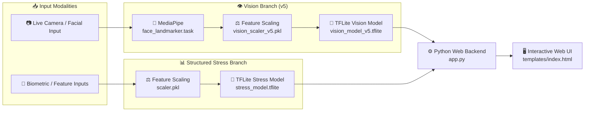

<div align="center">


# 🧠 Multimodal AI Stress Detector
### Real-Time Computer Vision & Lightweight Edge-AI Stress Assessment Platform

[](https://www.python.org/)
[](https://www.tensorflow.org/lite)
[](https://developers.google.com/mediapipe)
[](https://www.docker.com/)

An end-to-end, containerized AI web application combining **MediaPipe facial landmark analysis** and **dual TensorFlow Lite (`.tflite`) models** for fast, low-latency stress detection through an interactive web interface.

[📌 Overview](#-overview) • [🏗️ Architecture](#️-system-architecture--inference-pipeline) • [🧠 AI Models](#-ai-models--artifacts) • [🚀 Quick Start](#-quick-start) • [🐳 Docker](#-run-with-docker)

</div>

---

## 📌 Overview

**Multimodal AI Stress Detector (PPD-1 Product)** brings lightweight, on-device-ready machine learning to real-time stress screening. Instead of relying on heavy cloud GPUs, the system runs quantized/compact **TensorFlow Lite** models paired with **MediaPipe's Face Landmarker** inside a unified Python web application (`app.py`) and ships with a ready-to-deploy `Dockerfile`.

### ✨ Key Highlights

* 👁️ **Real-Time Vision Stress Analysis:** Extracts high-precision facial geometry using MediaPipe's `face_landmarker.task`, normalizes features with `vision_scaler_v5.pkl`, and runs fast inference via `vision_model_v5.tflite`.
* 📊 **Dedicated Stress Inference Engine:** Processes structured stress indicators through `scaler.pkl` and an ultra-lightweight `stress_model.tflite` (~5.8 KB) for instant predictions.
* ⚡ **Ultra-Low-Latency Edge-AI Design:** Built around `.tflite` runtimes for minimal memory footprint and smooth real-time responsiveness even on CPU-only machines.
* 🖥️ **Rich Interactive Web Interface:** Self-contained frontend (`templates/index.html`) designed for live visual feedback, intuitive controls, and seamless user interaction.
* 🐳 **Production-Ready Docker Support:** Includes a `Dockerfile` for reproducible one-command builds across local machines and cloud platforms.

---

## 🏗️ System Architecture & Inference Pipeline



---

## 🧠 AI Models & Artifacts

| Artifact | Type | Size | Role in Pipeline |
| :--- | :---: | :---: | :--- |
| `face_landmarker.task` | MediaPipe Task | `3.76 MB` | Extracts facial landmarks & micro-expression geometry |
| `vision_model_v5.tflite` | TensorFlow Lite | `85.4 KB` | Classifies stress cues from extracted facial features (v5) |
| `vision_scaler_v5.pkl` | Scikit-Learn Scaler | `1.88 KB` | Standardizes vision feature vectors before TFLite inference |
| `stress_model.tflite` | TensorFlow Lite | `5.87 KB` | Ultra-compact model for structured stress classification |
| `scaler.pkl` | Scikit-Learn Scaler | `522 B` | Normalizes structured input features to match training distribution |

---

## 📂 Repository Structure

```text
stress-detector-main/
└── PPD1_Product/
    ├── app.py                   # Main Python web server & TFLite/MediaPipe inference backend
    ├── Dockerfile               # Container definition for portable deployment
    ├── requirements.txt         # Python runtime dependencies
    ├── face_landmarker.task     # MediaPipe Face Landmarker model bundle
    ├── vision_model_v5.tflite   # Vision-based stress detection model (v5)
    ├── vision_scaler_v5.pkl     # Feature scaler for vision model
    ├── stress_model.tflite      # Structured/biometric stress prediction model
    ├── scaler.pkl               # Feature scaler for stress model
    ├── static/
    │   └── logo.png             # Project / institute branding asset
    └── templates/
        └── index.html           # Interactive web dashboard frontend
```

---

## 🚀 Quick Start

<details open>
<summary><b>💻 Option 1: Run Locally (Python Virtual Environment)</b></summary>

1. **Clone the repository and navigate to the product directory:**
   ```bash
   git clone [https://github.com/](https://github.com/)<your-username>/stress-detector.git
   cd stress-detector/PPD1_Product
   ```

2. **Create and activate a virtual environment:**
   ```powershell
   # Windows (PowerShell)
   python -m venv .venv
   .\.venv\Scripts\Activate.ps1
   ```
   ```bash
   # macOS / Linux
   python3 -m venv .venv
   source .venv/bin/activate
   ```

3. **Install dependencies:**
   ```bash
   pip install -r requirements.txt
   ```

4. **Launch the application:**
   ```bash
   python app.py
   ```
   Open your browser and visit `http://127.0.0.1:5000` *(or the port configured in `app.py`)*.

</details>

---

## 🐳 Run with Docker

<details>
<summary><b>📦 Option 2: Build & Run Containerized App</b></summary>

1. **Build the Docker image:**
   ```bash
   cd PPD1_Product
   docker build -t stress-detector .
   ```

2. **Run the container:**
   ```bash
   docker run -p 5000:5000 stress-detector
   ```
   *(Update `-p <host_port>:<container_port>` to match the `EXPOSE` port inside `Dockerfile`, e.g., `7860:7860` for Hugging Face Spaces or `5000:5000` for Flask.)*

</details>

---

## 🛠️ Tech Stack

| Layer | Technology |
| :--- | :--- |
| **Backend** | Python (`app.py`) |
| **Computer Vision** | MediaPipe Face Landmarker (`face_landmarker.task`) |
| **Edge ML Runtime** | TensorFlow Lite (`.tflite`) + Pickle Scalers (`.pkl`) |
| **Frontend** | HTML5, CSS3, JavaScript (`templates/index.html`) |
| **Deployment** | Docker (`Dockerfile`) |

---

<div align="center">
  Built with ❤️ for AI-Powered Wellness & Real-Time Stress Screening • <strong>PPD-1 Product</strong>
</div>
